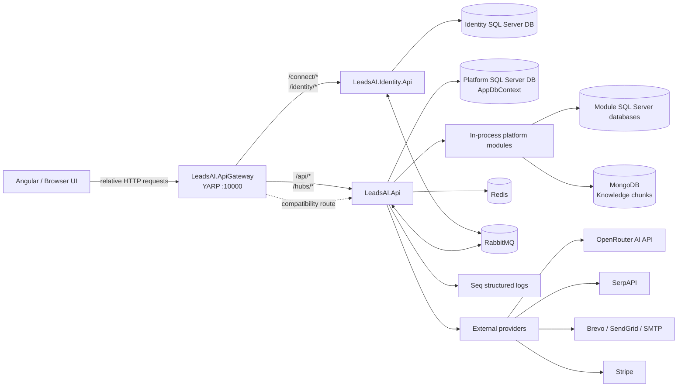
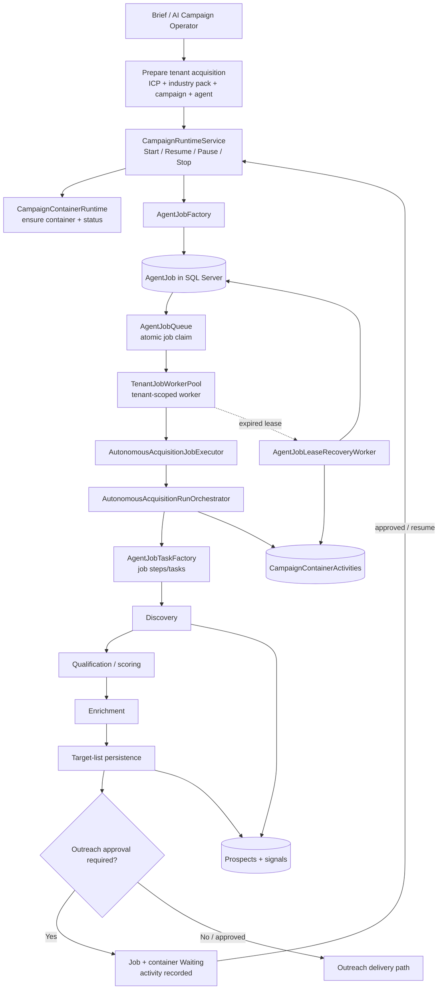

# LeadsAI — High-Level Architecture (Repository-Verified)

> **Scope:** this document describes components found in the current `refactor/tenant-job-runtime` branch. It distinguishes code that exists from external services that require configuration and from runtime behavior that still needs end-to-end verification. It is an implementation map, not a claim that every flow is production-ready.

## 1. System context

### Deployable hosts and boundaries

| Host / boundary | Repository evidence | Responsibility |
|---|---|---|
| `LeadsAI.ApiGateway` | `src/ApiGateway/LeadsAI.ApiGateway` | YARP reverse proxy. Routes identity/token traffic to Identity and platform API/hub traffic to the platform host. |
| `LeadsAI.Identity.Api` | `src/Identity/LeadsAI.Identity.Api` | OpenIddict/token endpoint, ASP.NET Identity users, tenants, roles, permissions and licensing APIs. |
| `LeadsAI.Api` | `src/Platform/Presentation/LeadsAI.Api` | Main HTTP host: CRM/acquisition/campaign APIs, middleware, SignalR, billing endpoints and module composition. |
| Platform modules | `src/Platform/Modules/*` | AI Orchestration, Automation, Integrations, Knowledge and Notifications are module projects loaded into the platform process; they are **not separate web hosts** in the current deployment. |
| Infrastructure and persistence | `src/Platform/Infrastructure`, `src/Platform/Persistence` | Business services, provider adapters, worker services, repositories and EF Core persistence. |

Gateway route contract documented in `ARCHITECTURE.md`:
- `/connect/*` and `/identity/*` → Identity API.
- `/api/*` and `/hubs/*` → Platform API.
- `/services/{module}/*` → compatibility route to `/api/modules/{module}/*`.

## 2. Platform API surface present in the repository

These are controller/endpoint groups found in the current API project. The table is grouped by responsibility; it does not imply every endpoint has been exercised in a live environment.

| API area | Current controller / endpoint files |
|---|---|
| Acquisition setup and orchestration | `AiCampaignOperatorEndpoints`, `AutonomousAcquisitionEndpoints`, `AutonomousAcquisitionE2eEndpoints`, `AutonomousAcquisitionVerificationEndpoints`, `AcquisitionTenantSettingsEndpoints`, `AcquisitionOverviewController`, `DiscoveryController`, `IcpController`, `TargetListsController` |
| Campaign lifecycle and runtime | `CampaignsController`, `CampaignContainersController`, `TenantRuntimeController`, `TenantWorkersController`, `CampaignRuntimeService`, `CampaignContainerConfigurationService` |
| Prospects and CRM | `ProspectsController`, `CrmController`, `InboxController`, `EmailOperationsController`, `MeetingsController`, `TicketsController` |
| AI and knowledge | `AiController`, `AiAgentController`, `AiAdvisorController`, `AiAdvisorModelController`, `KnowledgeController`, `EvaluationsController`, `PublicChatEndpoints`, `ConversationHub` |
| Automation and workflow | `AutomationsController`, `WorkflowsController`, `EnterpriseWorkflowController`, `AutomationAnalyticsEndpoints` |
| Tenant, access and operations | `TenantProvisioningController`, `TenantLifecycleEndpoints`, `SecurityController`, `PlatformController`, `EnterpriseOperationsController`, `EnterpriseOperationsEndpoints` |
| Billing and commercial platform | `BillingController`, `BillingQueryEndpoints`, `BillingWebhookEndpoints`, `BillingHardeningEndpoints`, `BillingVerificationEndpoints`, `FinanceEndpoints`, `RevenueController`, `SalesController`, `WhiteLabelController`, `WorkspacePackagesController`, catalog endpoints/controllers |

### Request security path

The platform host registers authentication and applies tenant/access/billing middleware in this order after authentication:

1. `TenantMiddleware` — establishes request tenant context.
2. `TenantEntitlementEnforcementMiddleware` — enforces tenant entitlement state.
3. `TenantAccessMiddleware` — validates access to the tenant.
4. `BillingQuotaMiddleware` — enforces billing quota.
5. Authorization policies and endpoint permission checks.

MediatR pipeline behaviors are also registered for tenant validation, permission authorization, license entitlement, module entitlement and request validation. Identity is the source of truth for tenant/licensing/access state; the platform consumes entitlement events to maintain local projections.

## 3. Acquisition runtime — the main execution path

### Runtime components found in code

| Component | Role |
|---|---|
| `CampaignRuntimeService` | Coordinates campaign/agent/container lifecycle for manual start, resume, pause and stop. |
| `CampaignContainerRuntime` | Owns container status transitions and container creation/ensure behavior. |
| `AgentJobFactory` / `IAgentJobFactory` | Creates the canonical persisted acquisition job. |
| `AgentJobQueue` / `IAgentJobQueue` | Claims queued jobs using SQL Server locking/conditional updates. |
| `TenantJobWorkerPool` | Discovers active tenants and runs tenant-scoped worker execution with tenant context. |
| `AutonomousAcquisitionJobExecutor` | Entry point for executing an acquisition job. |
| `AutonomousAcquisitionRunOrchestrator` | Runs acquisition steps, renews job lease, handles completion/wait/failure and records container activity. |
| `AgentJobTaskFactory` | Creates the task/step records belonging to a job. |
| `AgentJobLeaseRecoveryWorker` | Reconciles expired running-job leases: requeues while retries remain or marks failed when attempts are exhausted; reconciles related task/container state and writes activity. |
| `CampaignContainerActivityRecord` | Durable operational timeline for a container/run/step. Operational activity is separate from admin/security `AuditLogs`. |

### Important runtime qualification

The infrastructure dependency registration also contains `AutonomousAcquisitionSchedulerWorker` and `CampaignExecutionWorker`, in addition to the canonical `TenantJobWorkerPool`; `OutreachDeliveryWorker` is another background worker. These registrations exist in code. Their possible overlap with the canonical job path and their production responsibilities should be verified before claiming there is only one active execution path. The intended canonical acquisition runtime is **Campaign → Container → AgentJob → TenantJobWorkerPool → Executor/Orchestrator**.

## 4. Internal services and modules

| Internal component | Current role / boundary |
|---|---|
| Platform application services | CRM and support repositories, workflow automation, billing, tenant lifecycle/provisioning, industry-pack provisioning, workspace-package installation and usage metering. |
| AI Orchestration module | Own Domain/Application/Infrastructure/Persistence projects and provider-facing AI orchestration capabilities; composed into the platform process. |
| Automation module | Automation definitions and execution support; platform also registers scheduler/retry/analytics workers and an automation action executor. |
| Integrations module | Own integration domain and persistence boundary. The API additionally registers a generic webhook integration provider. |
| Knowledge module | Knowledge base/retrieval APIs and infrastructure; SQL-backed retrieval plus MongoDB document chunks per architecture configuration. |
| Notifications module | Separate module projects and database; not a separate web host. |
| Identity event consumers | `IdentityEntitlementConsumers` and `IdentityEntitlementInboxProcessor` propagate entitlement changes to platform projections using messaging/inbox patterns. |
| Tenant lifecycle and provisioning | Tenant lifecycle orchestrator, license-change orchestrator, module provisioning orchestrator/retry worker, lifecycle reconciliation and license-expiration worker. |
| Email operations | Email delivery service/providers and `OutreachDeliveryWorker`; delivery is configuration-dependent. |

## 5. External services and infrastructure

The following are evidenced by project registration/configuration. **Configured in code does not mean credentials are present or the integration is currently healthy.**

| Service | Code/config evidence | Purpose and current qualification |
|---|---|---|
| SQL Server | Multiple EF Core contexts and connection strings | Primary relational store for platform, Identity and module data. Connection strings must come from deployment secrets/environment; checked-in appsettings contain development defaults. |
| Redis | `AddServiceDefaults`, `Redis:ConnectionString` | Distributed cache. |
| RabbitMQ | MassTransit setup in `LeadsAI.BuildingBlocks.Messaging`; Identity outbox and platform consumers documented in `ARCHITECTURE.md` | Integration events and tenant-entitlement propagation. |
| MongoDB | Knowledge module architecture/configuration | Knowledge chunks/document storage. |
| Seq | `Seq:Url` and deployment configuration | Centralized structured logs. |
| OpenRouter | `OpenRouterAiProvider`, registered as `IAiProvider` | External LLM provider; requires valid provider configuration/key and successful runtime verification. |
| SerpAPI | `SerpApiProspectDiscoveryProvider`, registered as `IProspectDiscoveryProvider` | External web search for prospect discovery. Current appsettings example has an empty API key, so live discovery is not enabled by that file alone. Provider includes account/quota checks. |
| Brevo | `BrevoEmailProvider`, HTTP client base `https://api.brevo.com/v3/` | Email delivery adapter; requires API key and provider selection/configuration. |
| SendGrid | `SendGridEmailProvider` and configuration section | Email delivery adapter; requires credentials/configuration. |
| SMTP | `SmtpEmailProvider` and configuration section | Alternative email delivery. |
| Stripe | `StripeBillingProvider`, registered as `IBillingProvider` | Billing provider adapter; requires credentials and configured billing flow. |
| Generic webhooks | `GenericWebhookIntegration`, registered as `IIntegrationProvider` | Configurable outbound integration/webhook adapter. |
| Identity API | `Identity:Authority` setting | JWT authority for the platform API; internal service-to-service dependency. |

### Demo and live-provider distinction

- `RenovaDemoProspectDiscoveryProvider` exists as a deterministic demo source.
- The shown infrastructure registration wires `SerpApiProspectDiscoveryProvider` to `IProspectDiscoveryProvider`; do not assume the demo provider is active in dependency injection without checking the active registration/configuration.
- The checked-in API settings have SerpAPI and email secrets empty and email provider set to `disabled`. Therefore this configuration alone does **not** demonstrate working live discovery or email delivery.
- External API calls, valid secrets, provider selection, quota availability, webhook delivery and actual recipient delivery require environment-level verification.

## 6. Data ownership and operational traceability

| Data / store | Ownership |
|---|---|
| `AgentJobs` | Durable acquisition work queue and runtime status/lease/attempt state. |
| `CampaignContainers` | Container/session lifecycle and current status. |
| `AutonomousAcquisitionTasks` | Step/task state associated with a job; not intended as a second independent job queue. |
| `CampaignContainerActivities` | Operational event/timeline records with tenant, container, run, task, step and event metadata. |
| Prospects / ProspectSignals | Discovered and scored company records plus evidence/source signals. |
| TargetLists / TargetListMembers | Persisted qualified-account lists and membership. |
| AuditLogs | Administrative/security audit records; not the operational runtime timeline. |
| Identity and module databases | Separate persistence contexts for Identity, Automation, Notifications, Knowledge, AI Orchestration and Integrations. |

## 7. Roadmap from the implementation we actually have

### Phase A — Close and verify acquisition backend (current priority)
- Run database migrations against the intended environment and confirm the `CampaignContainerActivities` migration and current EF model are aligned.
- Execute the FusionFleet end-to-end flow: brief → ICP/pack → campaign/agent/container → AgentJob → discovery → scoring/qualification → enrichment → target list → approval gate → outreach.
- Verify every stage persists records and produces a traceable container activity/history entry.
- Verify tenant isolation, entitlements and permissions on direct API calls, not only through the UI.
- Resolve/confirm the responsibilities of the registered scheduler/execution workers against the canonical AgentJob runtime.
- Prove pause/resume/stop, approval waiting, retry, lease expiry/recovery and idempotency with integration tests.
- Validate live-provider configuration separately from demo/test data.

### Phase B — Reliability and security
- Add/complete automated tests for tenant isolation, job claims, worker shutdown, retries, duplicate prevention and concurrent tenants.
- Confirm quotas, provider timeouts, cancellation and error reporting are consistent across API and workers.
- Add runtime health/metrics/alerts for queue depth, lease recovery, provider failures and outreach delivery.

### Phase C — Durable integration events
- Complete and verify transactional outbox/inbox delivery and idempotent consumers where events cross module boundaries.
- Keep the existing in-process module boundaries until operational evidence justifies splitting a module into a separate host.

### Phase D — Production operations
- Verify CI builds the actual Admin UI (current CI previously skipped its npm build because the expected lockfile was absent).
- Validate staging deploy, secrets, migrations, backup/restore, retention and rollback.
- Load-test multiple tenants and concurrent campaigns before choosing further scale-out architecture.

### Phase E — AI/product maturity
- Distinguish model-generated plans from deterministic/template-based preparation in UI and logs.
- Add provider health/fallback, evaluation, usage/cost accounting and outcome analytics.
- Expand the integration catalog only when each provider has a verified contract, secret lifecycle, retries and observability.

## 8. Verification status and non-claims

- Repository code and DI registrations were inspected to assemble this document.
- A previous CI run on this branch reported backend build and billing-hardening tests passing; the Admin UI job did not execute its npm build because the expected lockfile was missing.
- This document does **not** claim that database migrations were applied to a live database, that the full acquisition E2E script passed, or that external provider credentials are valid.
- Update this document when a provider becomes active, a worker is removed/merged, or an E2E verification gate is completed.

## 9. Useful source files

- `ARCHITECTURE.md`
- `DEVELOPMENT_ROADMAP.md`
- `src/Platform/Presentation/LeadsAI.Api/Program.cs`
- `src/Platform/Presentation/LeadsAI.Api/Middleware/TenantMiddleware.cs`
- `src/Platform/Presentation/LeadsAI.Api/Middleware/TenantEntitlementEnforcementMiddleware.cs`
- `src/Platform/Presentation/LeadsAI.Api/Middleware/TenantAccessMiddleware.cs`
- `src/Platform/Presentation/LeadsAI.Api/Services/CampaignRuntimeService.cs`
- `src/Platform/Infrastructure/LeadsAI.Infrastructure/DependencyInjection.cs`
- `src/Platform/Infrastructure/LeadsAI.Infrastructure/Acquisition/AgentJobQueue.cs`
- `src/Platform/Infrastructure/LeadsAI.Infrastructure/Acquisition/TenantJobWorkerPool.cs`
- `src/Platform/Infrastructure/LeadsAI.Infrastructure/Acquisition/AutonomousAcquisitionJobExecutor.cs`
- `src/Platform/Infrastructure/LeadsAI.Infrastructure/Acquisition/AutonomousAcquisitionRunOrchestrator.cs`
- `src/Platform/Infrastructure/LeadsAI.Infrastructure/Acquisition/AgentJobLeaseRecoveryWorker.cs`
- `src/Platform/Infrastructure/LeadsAI.Infrastructure/Acquisition/ProspectDiscoveryService.cs`
- `src/Platform/Infrastructure/LeadsAI.Infrastructure/Email/EmailDelivery.cs`
- `src/Platform/Infrastructure/LeadsAI.Infrastructure/OpenRouterAiProvider.cs`
